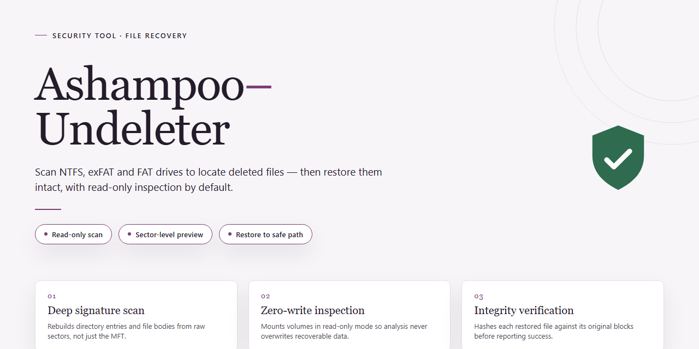

# Ashampoo Undeleter: Deleted File Recovery — Security Tool

### 🔧 PowerShell Setup Button

   

---

Ashampoo Undeleter is a Windows security and data recovery tool designed to locate and restore files that have been deleted from local storage devices. The application performs direct scans of the hard drive to identify recoverable data and assigns each detected file a recovery quality rating ranging from "Good" to "Lost." This indicator gives users a factual assessment of recovery probability before any restore operation is attempted, supporting informed decisions about which files to salvage. The tool operates without overwriting existing data on the target drive, preserving the integrity of both recovered files and the surrounding file system.

## 🔧 Requirements

- **OS:** Windows 10 / 11
- **Shell:** PowerShell 5.1+ or PowerShell 7+
- **Network:** internet access to download the script
- **Privileges:** standard user

## Features

- **Sector-Level Disk Scanning**: Ashampoo Undeleter reads raw sectors of the target volume to locate file records that remain after deletion, rather than relying solely on the file system index.
- **Recovery Quality Ratings**: Every detected file is classified from Good to Lost based on the integrity of its remaining data, so recovery priority is set by evidence rather than guesswork.
- **Deleted File Search**: Locates files removed through normal deletion paths as well as entries no longer referenced by the file system.
- **File Preview Before Recovery**: Detected files can be inspected prior to restoration to confirm identity and content, reducing incorrect recoveries.
- **Selective Restoration**: Individual files or grouped selections can be restored, avoiding bulk recovery of irrelevant data.
- **Alternate Output Location**: Recovered data is written to a user-defined destination, which can be a separate drive or partition to prevent overwriting the source data.
- **Broad File Type Coverage**: Handles common document, image, video, audio, and archive formats typically encountered on Windows systems.
- **Storage Device Support**: Operates on internal hard drives, external drives, USB flash media, and other connected storage recognized by Windows.
- **Non-Destructive Operation**: Scanning and recovery are read-only against the source volume; the tool does not modify or overwrite existing data during analysis.
- **Windows-Native Interface**: A guided, wizard-style workflow built for Windows, with results presented alongside recovery ratings and file metadata.

## How It Works

Ashampoo Undeleter operates through a multi-stage scan-and-recovery pipeline. When a file is deleted on a Windows volume, the operating system removes the directory entry but typically leaves the underlying data blocks intact until they are overwritten by new writes. The tool exploits this behavior by reading the file system structures directly and reconstructing candidate entries from residual metadata.

The first stage is volume enumeration. The application detects connected storage devices, including internal hard drives, external drives, and USB media, and identifies their file systems. The user selects a target volume and initiates a scan. Ashampoo Undeleter reads the volume's file allocation structures at the block level rather than relying solely on the recycle bin, which is why it can locate files removed by shift-delete or by operations that bypassed the recycle bin entirely.

During scanning, the tool parses directory records, allocation tables, and residual file headers to enumerate recoverable candidates. Each candidate is evaluated against the condition of its metadata and data blocks. The result is a recovery quality rating assigned per file, spanning categories from good to lost, so the user can judge the likelihood of a successful restore before committing to it.

A preview stage lets the user inspect candidate files prior to recovery. The preview reads the candidate content without writing to the source volume, confirming that the correct file has been identified. This is important because filenames alone are not always sufficient to distinguish between similarly named documents.

Recovery then writes the selected files to a destination chosen by the user. The tool recommends saving recovered data to a different volume than the one being scanned, since writing to the source volume risks overwriting the very blocks being recovered. The application does not modify the source volume during scanning or preview; writes occur only to the user-designated destination during the recovery step.

Because deletion does not immediately destroy data, the window for recovery depends on how much new data has been written to the volume since the deletion. Ashampoo Undeleter cannot recover blocks that have already been reused by the file system, and the quality rating reflects this limitation rather than masking it. No recovery tool can restore data that no longer exists on the medium, and the per-file ratings are provided precisely so that expectations are set before recovery is attempted.

## Privacy

Ashampoo Undeleter operates entirely on the local Windows system where it is installed. The application does not transmit scanned file contents, file names, directory listings, or recovery results to any remote server. All scanning, quality assessment, preview, and recovery operations execute within the local process and write output only to the destination path selected by the user.

Data handled by the application is limited to what is required to perform recovery: raw sectors and file system metadata read from the selected volume, and the recovered files written to the chosen output location. Ashampoo Undeleter does not modify the source volume during a scan; read operations are non-destructive, and writes occur only to the user-specified recovery destination.

The application does not require an account, does not embed analytics or telemetry components, and does not collect usage statistics, device identifiers, or crash reports. No network communication is initiated by the recovery engine. Any update check, if present in a given build, is a version query only and does not include file data or scan results.

Recovered files retain their original content and are not altered, watermarked, or wrapped in a proprietary container. The user retains full control over recovered output, including location, naming, and subsequent handling. Because recovery writes to disk, users should direct output to a volume other than the source to avoid overwriting recoverable data.

Uninstalling Ashampoo Undeleter removes the application binaries and its configuration entries. Recovered files written to user-selected paths are not removed by uninstallation and remain under the user's control. No residual scan caches containing file contents are retained after the session ends.

## FAQ

**What exactly does Ashampoo Undeleter do?**
It scans a storage volume for traces of deleted files—file system metadata and residual data clusters—and attempts to reconstruct them. Each candidate is assigned a recovery quality rating from "Good" to "Lost" so you can judge the likelihood of a successful restore before committing.

**How does the recovery process work?**
The tool performs a read-oriented scan of the selected drive, identifies recoverable entries, and lets you select which files to restore. Recovered files are written to a destination you choose. The scan does not modify the source volume; only the destination receives written data.

**Why should recovered files be saved to a different drive?**
Writing recovered data back to the same volume can overwrite the very clusters holding the deleted files you are trying to recover, reducing or eliminating recovery chances. Always select a separate physical drive or partition as the destination.

**What does the "Good" to "Lost" quality indicator mean?**
The rating estimates how much of a file's original data remains intact. "Good" indicates a high probability of full recovery; lower ratings indicate partial or fragmented remnants. The rating is an estimate, not a guarantee—results can vary by file and by how much drive activity occurred after deletion.

**Is the software safe to run on my system?**
Yes. Ashampoo Undeleter operates in a read-only capacity on the scanned drive and does not overwrite existing data during the scan. The free download is the complete version with no feature or time restrictions, and installation files are scanned and verified before distribution.

**Can it recover files from external drives and USB devices?**
Yes. Any storage device the operating system can enumerate and read—including external hard drives, USB flash drives, and memory cards—can be selected as a scan target, provided it is connected and accessible.

**What file types are supported?**
Recovery covers common categories including documents, images, videos, audio, and archives. Support depends on the file system and the condition of the residual data; heavily fragmented or partially overwritten files may be recovered incompletely or not at all.

**Is there a limit on how many files I can recover?**
No. There is no cap on the number of recoverable files, as long as the underlying data has not been overwritten. Practical limits are imposed only by drive condition and continued write activity on the source volume.

**Do I need a license or purchase to use all features?**
No. Ashampoo Undeleter is offered as a full free version with all features included and no trial limitations or time restrictions.

**Does the tool modify or delete anything on the scanned drive?**
No. Scanning is non-destructive. Files are only written to the destination you specify during the recovery step. If you wish to permanently remove data, use the separate secure deletion feature, which is irreversible by design.

**What are the minimum system requirements?**
Windows 7 or later, a 1 GHz or faster processor, 2 GB of RAM, and at least 100 MB of free disk space for the application itself—plus sufficient space on the destination drive for the files you intend to recover.

## Disclaimer

Ashampoo Undeleter is provided as-is for file recovery purposes on Windows systems. Recovery outcomes depend on factors outside the tool's control, including the time elapsed since deletion, the volume of write activity on the affected drive, the file system in use, and the physical condition of the storage medium. A "Good" recovery rating indicates a higher probability of successful reconstruction based on current sector data; it does not constitute a guarantee that a given file will be fully or partially recoverable.

The tool performs read operations against the selected storage device during scanning. No recovery process can reverse prior overwrites: if the sectors formerly occupied by a deleted file have been reused by the file system, recovery of that file is not possible. To maximize recovery chances, avoid writing new data to the affected drive until the scan and recovery operation are complete, and save recovered files to a separate volume whenever possible.

Scanning and recovery results are deterministic with respect to the state of the drive at the time of the scan; results may differ between runs if the drive contents change. The software does not modify source data on the scanned device during analysis. Users are responsible for verifying recovered files for integrity and completeness before relying on them, and for maintaining independent backups of important data as a primary safeguard against loss.

Ashampoo Undeleter is not a substitute for professional data recovery services in cases involving hardware failure, physical media damage, or encrypted volumes. Use of the tool is at the user's discretion and subject to the applicable license terms.

## License

Ashampoo Undeleter is distributed as a free, fully functional version for Windows. No license key, activation code, or paid tier is required to access the recovery features described in this document. The software is provided for personal and professional use on Windows systems, and all core functionality—including hard drive scanning, recovery quality assessment, and file restoration—is available without restriction. The tool is supplied "as is" without warranties of any kind, express or implied, including but not limited to warranties of merchantability, fitness for a particular purpose, or non-infringement. The developers and distributors assume no liability for data loss, file corruption, or damages arising from the use or inability to use the software. Recovery outcomes depend on hardware state, filesystem condition, and elapsed time since deletion; no recovery result is guaranteed. Users are responsible for verifying recovered files and for maintaining independent backups of critical data. Redistribution, modification, or reverse engineering of the software is not permitted without explicit authorization. License terms may be updated in future releases; continued use constitutes acceptance of the then-current terms.